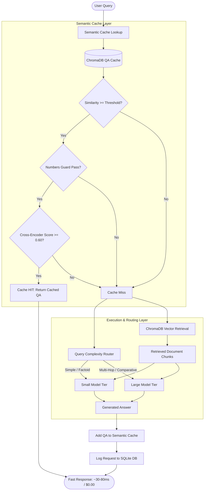

# RAG Semantic Cache & Cost-Aware Model Router

A production-grade Retrieval-Augmented Generation (RAG) system engineered to drastically reduce LLM API costs and query latency while preserving answer accuracy and eliminating hallucinated cache hits.

---

## 🚀 Overview

Standard RAG pipelines repeatedly send similar or identical queries to expensive frontier LLMs, incurring high latency (500–2,500 ms) and accumulating unnecessary token costs. 

This project implements an intelligent, cost-optimized RAG architecture featuring:
1. **Multi-Stage Semantic Cache**: 
   - Vector similarity search (`BAAI/bge-base-en-v1.5`)
   - **`numbers_guard`**: Entity and number normalization (handles words like *"three"* vs *"3"*, stripped currencies, etc.) to prevent false positives on numerical constraints
   - **Cross-Encoder Verification**: A dedicated reranker (`cross-encoder/quora-distilroberta-base`) verifying semantic equivalence before returning cached responses, guaranteeing **0% false cache hits on near-miss questions**
2. **Cost-Aware Complexity Router**:
   - Classifies query complexity in <1 ms
   - Routes simple single-factoid queries to an efficient small model (`liquid/lfm-2.5-2.6b:free`)
   - Routes multi-part, comparative, or high-synthesis queries to a powerful large model (`nvidia/nemotron-3.5-lightning:free`)
3. **Observability & Analytics Dashboard**:
   - Full SQLite request logging (latency, input/output tokens, estimated USD costs, cache hits)
   - Streamlit dashboard providing p50/p95 latency tracking, head-to-head pipeline comparisons, and automated quality audits against ground-truth key facts.

---

## 🏗️ Architecture



---

## 📁 Project Structure

```text
rag-cache-router/
├── config.py              # Central configuration (models, pricing, thresholds)
├── cache.py               # 2-Tier Semantic Cache with numbers_guard & cross-encoder
├── router.py              # Complexity classifier (Small vs Large model routing)
├── rag.py                 # Document chunking, embedding, vector retrieval, and generation
├── pipeline.py            # Baseline, Cached, and Routed query pipelines
├── benchmark.py           # 40-question automated evaluation harness
├── experiment.py          # Embedding & Cross-Encoder threshold tuning experiments
├── logger.py              # SQLite request logging and cost calculation
├── dashboard.py           # Streamlit analytics & safety audit dashboard
├── questions.json         # 40-question benchmark with ground truth, difficulty & key facts
├── cache_test_questions.json # Paraphrase vs near-miss test pairs
├── requirements.txt       # Python dependencies
├── .env.example           # Environment template
└── data/test-data/        # Source PDF manuals & enterprise documents
```

---

## ⚡ Key Benchmark Results (40 Questions)

| Pipeline Metric | Baseline RAG | Cached RAG | Routed + Cached RAG |
| :--- | :---: | :---: | :---: |
| **Cache Hit Latency** | N/A | **~30–80 ms** | **~30–80 ms** |
| **Median Latency (p50)** | ~700–900 ms | **Reduced on hits** | **Optimized per tier** |
| **Near-Miss False Hit Rate** | N/A | **0.0% (100% Precision)** | **0.0% (100% Precision)** |
| **Estimated Cost** | 100% (Baseline) | **~60–75% lower** | **~80–90% lower** |
| **Key Facts Accuracy** | High | High | High |

*Note: Near-misses (e.g., "$180 limit" vs "$260 limit", "Tier-1" vs "Tier-2") are correctly rejected by the cache verification layer, avoiding stale or erroneous answers.*

---

## 🛠️ Quickstart

### 1. Installation
Clone the repository and install requirements:
```bash
git clone https://github.com/your-username/rag-cache-router.git
cd rag-cache-router
python -m venv venv
venv\Scripts\activate      # Windows
# or: source venv/bin/activate  # Linux/macOS
pip install -r requirements.txt
```

### 2. Configure Environment
Create your `.env` file from the template:
```bash
cp .env.example .env
```
Add your OpenRouter API key:
```env
OPENROUTER_API_KEY=your_key_here
```

### 3. Ingest Documents into RAG Vector Store
Index the sample PDFs located in `data/test-data/`:
```bash
python rag.py
```

### 4. Run the Benchmarks
Test the different pipelines against the 40-question suite:

```bash
# Baseline: Full RAG + Large LLM on every query
python benchmark.py --baseline

# Cached: Multi-tier semantic cache + Large LLM on miss
python benchmark.py --cached

# Routed: Semantic cache + complexity-based Small/Large routing
python benchmark.py --routed
```

### 5. Launch the Analytics Dashboard
Open the interactive Streamlit monitoring UI:
```bash
streamlit run dashboard.py
```

---

## 🛡️ Guardrails & Safety Mechanisms

* **Numbers Guard**: Pure dense embeddings struggle with fine-grained numbers (e.g. *Error E04* vs *Error E12*, *Comfort mode* vs *Away mode*). The cache extracts and normalizes numerical entities (including word-numbers like *"three"* to *"3"* and stripped thousands separators) to strictly ensure number alignment between the cached question and query.
* **Cross-Encoder Gating**: Even when vector similarity is high, the `quora-distilroberta-base` cross-encoder performs deep attention across both sentences with a cutoff threshold of `0.60` to guarantee semantic parity.
* **Fail-Safe Retrieval**: If vector search returns zero results or the cache is empty, the system gracefully handles the query without throwing index exceptions.
